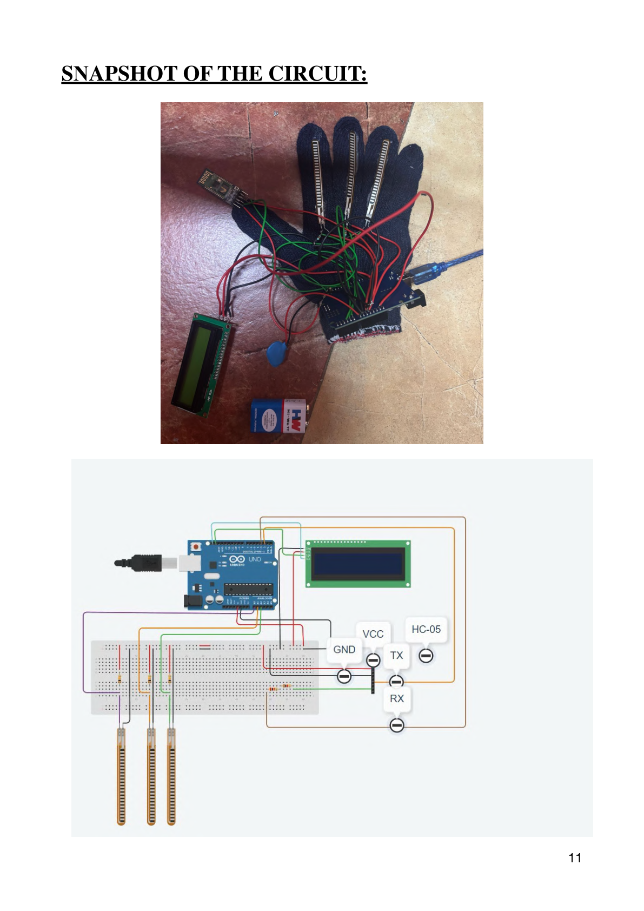
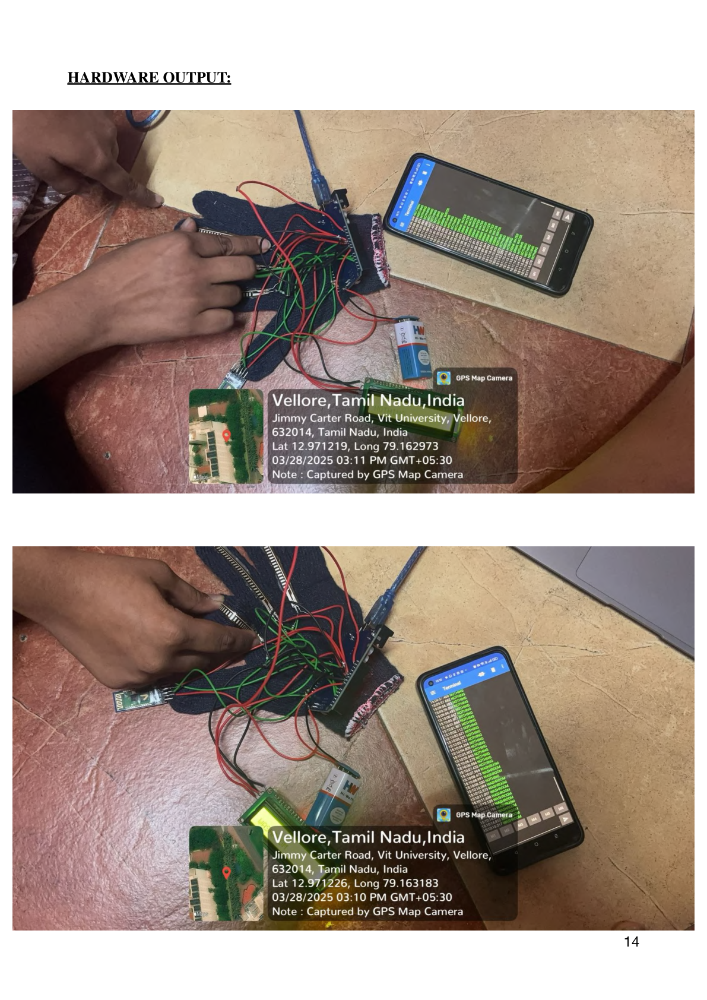
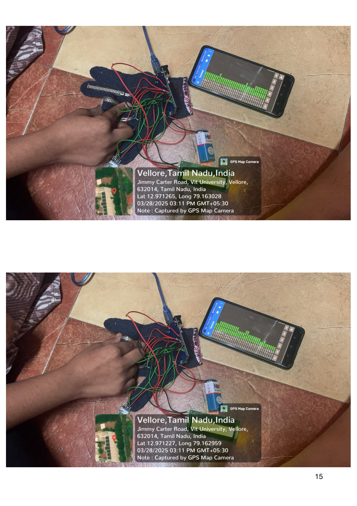

# Wearable Smart Communication Glove 🧤

A wearable assistive communication device that converts finger gestures into predefined messages using flex sensors, Arduino, an LCD display, and Bluetooth communication.

## 📌 Project Overview

The Wearable Smart Communication Glove is designed to help individuals with speech or communication difficulties express their basic needs through simple hand gestures.

The system uses three flex sensors to detect finger movements. An Arduino Uno processes the sensor readings and maps them to predefined messages. These messages are displayed on a 16×2 LCD and transmitted wirelessly to a smartphone using an HC-05 Bluetooth module.

## ✨ Features

- Gesture detection using three flex sensors.
- Threshold-based gesture recognition.
- Real-time message display on an LCD.
- Wireless message transmission using Bluetooth.
- Portable and low-cost assistive communication design.
- Serial monitoring of sensor readings for debugging.

## ⚙️ Hardware Components

| Component | Purpose |
|---|---|
| Arduino Uno | Main microcontroller |
| 3 Flex Sensors | Detect finger bending |
| 16×2 LCD with I2C | Display recognized messages |
| HC-05 Bluetooth Module | Transmit messages to smartphone |
| Resistors | Flex sensor voltage-divider circuits |
| Glove | Wearable platform |
| Connecting Wires | Circuit connections |

## 🔄 Working Principle

1. **Gesture Detection:** Three flex sensors measure finger bending through changes in their electrical resistance.
2. **Signal Processing:** Arduino reads the analog sensor values through pins A0, A1, and A2.
3. **Gesture Recognition:** A threshold-based algorithm identifies the corresponding gesture.
4. **Message Display:** The recognized message is displayed on the LCD.
5. **Bluetooth Communication:** The message is transmitted to a paired smartphone using the HC-05 module and serial communication.

## 📝 Gesture-to-Message Mapping

| Sensor Condition | Message |
|---|---|
| No sensor activated | NOTHING |
| Flex Sensor 1 bent | WASHROOM |
| Flex Sensor 2 bent | DRINK WATER |
| Flex Sensor 3 bent | FOOD |

The gesture thresholds in the current Arduino sketch are:
- Sensor 1: Greater than 200
- Sensor 2: Greater than 300
- Sensor 3: Greater than 700

These values may require calibration depending on the flex sensors and glove setup.

## 🔌 System Architecture

```text
Three Flex Sensors
        |
        v
    Arduino Uno
        |
        v
 Gesture Recognition
 (Threshold Algorithm)
        |
        +------------------+
        |                  |
        v                  v
   16×2 LCD          HC-05 Bluetooth
                           |
                           v
                       Smartphone
```

## 📷 Project Images

### Circuit Diagram


### Hardware Implementation




## 🧰 Software and Libraries

- Arduino IDE
- Embedded C / Arduino C++
- Wire Library
- LiquidCrystal_I2C Library
- SoftwareSerial Library

## 📁 Repository Structure

```text
Wearable-Smart-Communication-Glove/
│
├── docs/
│   └── Wearable_Glove_Project_Report.pdf
│
├── images/
│   ├── 01_Circuit_Diagram.png
│   ├── 02_Hardware_Output_1.png
│   └── 03_Hardware_Output_2.png
│
├── src/
│   └── wearable_communication_glove.ino
│
└── README.md
```

## 🚀 Applications

- Assistive communication for individuals with speech impairments.
- Healthcare facilities and hospitals.
- Communication support for elderly users.
- Industrial environments where verbal communication is difficult.
- Smart assistive technology applications.

## 🔮 Future Enhancements

- Machine learning-based recognition of complex gestures.
- Android application with a user-friendly interface.
- Voice output for recognized messages.
- Improved sensor calibration and gesture accuracy.
- Integration of haptic feedback.
- Health monitoring using additional sensors.

## 👥 Project Team

- Damini Katakam
- Karthik Selvaraj
- Goutham Krishna

## 🎓 Academic Details

**Course:** BECE304L – Analog Communication Systems  
**Institution:** Vellore Institute of Technology  
**Project Type:** Course-Based Project  
**Year:** 2025

---

<p align="center">
  <i>Technology that makes communication more accessible. 💙</i>
</p>
